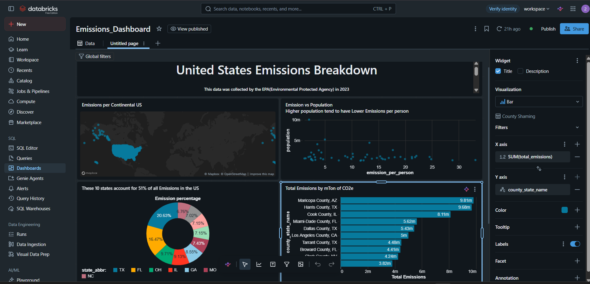
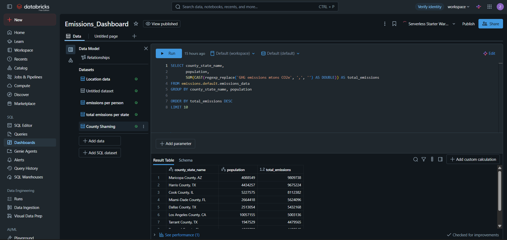
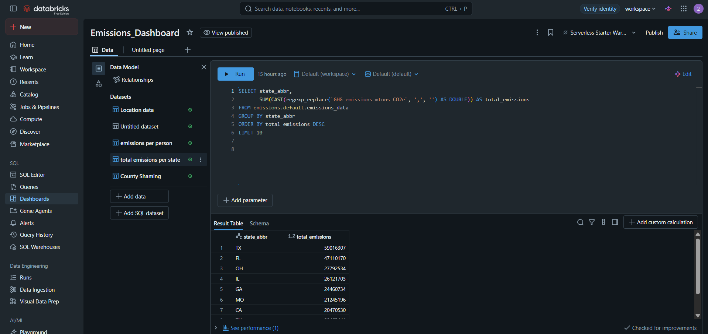
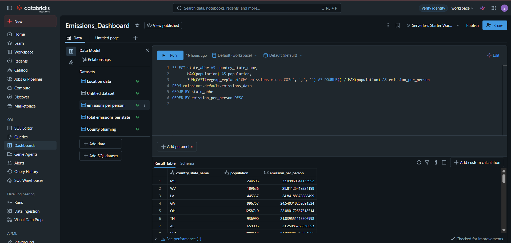
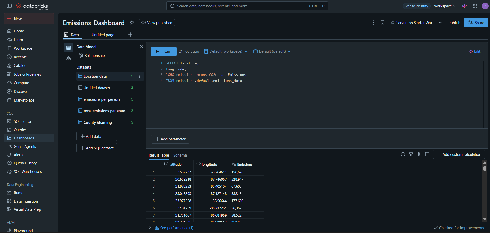

# US Emissions Analytics Dashboard

An interactive dashboard analyzing 2023 US greenhouse gas emissions using Databricks SQL.

## Dashboard Preview

## SQL Queries and Results

### 1. County-Level Emissions

### 2. State-Level Total Emissions

### 3. Emissions Per Person

### 4. Geographic Location Data

## Tools Used
- Databricks SQL
- SQL aggregations and CTEs
- Data visualization

## Key Learnings
- Analyzing emissions data across states and counties
- Writing SQL queries for aggregation and comparison
- Creating dashboard visualizations to communicate insights
